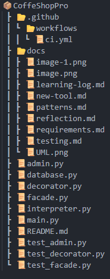

# CoffeeShopPro

A console-based coffee-shop ordering system demonstrating **three design patterns**
(Decorator, Facade, Interpreter) with persistent SQLite storage and a CI pipeline.

---

## 1. Overview

CoffeeShopPro lets a customer:

- Order a base coffee ($2.00)
- Add toppings (milk, sugar, whipped cream, caramel)
- Apply a promo code (HAPPYHOUR, WELCOME, STUDENT, WEEKEND, FIRSTORDER)
- Check out and see a receipt
- View past orders (persisted in SQLite)
- Act as an admin to add menu items

---

## 2. Design Patterns Used

| Pattern | Category | Module | Purpose |
|---|---|---|---|
| Decorator | Structural | `decorator.py` | Add toppings without class explosion |
| Facade | Structural | `facade.py` | Unified simple API hiding subsystem complexity |
| Interpreter | Behavioral | `interpreter.py` | Convert promo codes into discount percentages |

---

## 3. Project Structure

---

## 4. Setup & Run

Requires **Python 3.11+** and **coverage**.

    pip install coverage
    python main.py

---

## 5. Running the Tests

    python -m coverage run -m unittest discover
    python -m coverage report -m

Expected: `Ran 10 tests ... OK`, then a coverage table showing ~93%.

Test files:

- `test_decorator.py` — 4 tests, pure logic
- `test_facade.py` — 3 tests, uses `unittest.mock.MagicMock` to isolate the database
- `test_admin.py` — 3 tests, isolated in-memory SQLite

---

## 6. CI Pipeline

`.github/workflows/ci.yml` runs the full test suite on every push and pull
request to `main`. See the **Actions** tab in the repository.

---

## 7. Process Model

**Incremental.** The system was built in three increments: (1) design
patterns from Lab 2, (2) persistence and administration, (3) testing and CI.
Each increment produced a working artifact — see `docs/requirements.md` §6.

---

## 8. Author

- **M. M. Saklain** — CSE-3206, Roll: 2203040, Section A, RUET