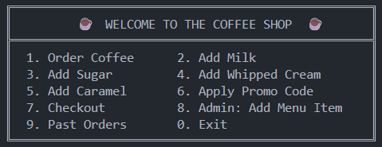

# Requirements — CoffeeShopPro

## 1. Problem Statement

Traditional coffee-shop ordering relies on verbal orders and manual receipts, which 
lead to order errors, pricing mistakes, and no history of past purchases. Customers 
want to customize drinks (milk, sugar, cream, caramel) and apply time-based promo 
codes. Shop owners need a way to view past orders and add new menu items.

CoffeeShopPro is a console application that addresses these problems with three 
design patterns — Decorator (customization), Facade (unified interface), and 
Interpreter (promo codes) — backed by persistent SQLite storage.

## 2. Functional Requirements

| ID   | Requirement                                                                 |
|------|-----------------------------------------------------------------------------|
| FR1  | A customer can order a base coffee priced at $2.00.                        |
| FR2  | A customer can add any combination of milk, sugar, whipped cream, caramel. |
| FR3  | Multiple toppings can be stacked on one beverage.                           |
| FR4  | A customer can apply a promo code from a defined set (see FR5).             |
| FR5  | Valid promo codes are HAPPYHOUR (20%), WELCOME (10%), STUDENT (15%), WEEKEND (25%), FIRSTORDER (30%). |
| FR6  | An invalid promo code leaves the total price unchanged.                     |
| FR7  | Checkout computes the final price and saves the order to persistent storage.|
| FR8  | A customer can view the history of all past orders.                         |
| FR9  | An admin can add a new menu item (name, price, category) to the database.   |
| FR10 | Invalid menu items (empty name or non-positive price) are rejected.         |

## 3. Non-Functional Requirements

| ID   | Requirement                                                                 |
|------|-----------------------------------------------------------------------------|
| NFR1 | The application must respond to any command within 1 second.                |
| NFR2 | Code must be extensible: adding a new topping must not modify existing classes (Open/Closed Principle). |
| NFR3 | Unit test coverage must be ≥ 90%.                                            |
| NFR4 | The app must run on any system with Python 3.11+ and no external services.   |
| NFR5 | Orders must persist between runs (SQLite file storage).                     |

## 4. User Stories

- **US1**: As a *customer*, I want to add milk to my coffee so that I can customize my drink.
- **US2**: As a *customer*, I want to apply a promo code so that I receive a discount.
- **US3**: As a *customer*, I want to view my past orders so that I can reorder quickly.
- **US4**: As an *admin*, I want to add new menu items so that the menu stays up to date.
- **US5**: As a *customer*, I want the menu displayed in a clear layout so that I can find options quickly.

## 5. Mock-up

## 6. Process Model — Incremental

**Chosen model: Incremental.**

**Justification:** The system was developed in three visible increments:
1. Design-pattern core (Lab 2): Decorator, Facade, Interpreter.
2. Persistence + administration module (this lab).
3. Test suite with mocks, and CI pipeline (GitHub Actions).

Each increment produced a working, demonstrable product, which matched my time 
budget. **Waterfall was rejected** because requirements were refined as modules were 
added (for example, the Admin module was introduced only after persistence existed). 
**Agile/Scrum was rejected** because formal sprints and daily stand-ups are excessive 
for a solo developer on a short timeframe.