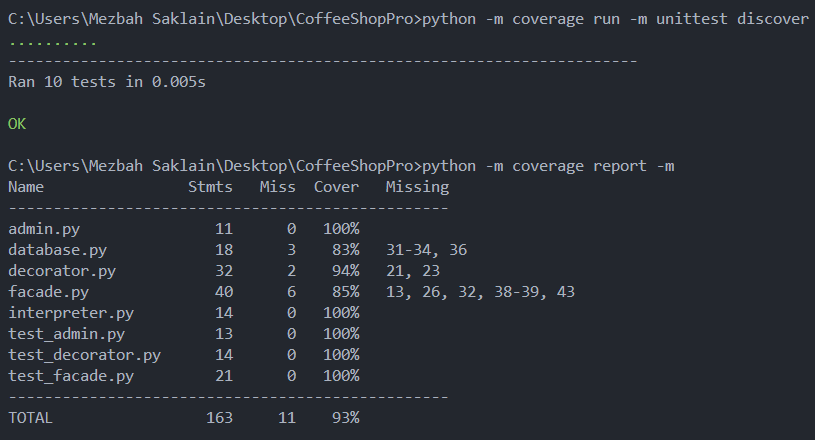

# Testing Report — CoffeeShopPro

## 1. Approach — Test-Driven Development (TDD)

Each unit test was written **before** its production code, following the 
Red → Green → Refactor cycle:
1. Write a failing test describing the desired behavior.
2. Write the minimum code to make it pass.
3. Refactor for clarity while keeping the test green.

## 2. Test Files and Coverage



**Total: 10 unit tests.**

## 3. Mock Usage — Isolating the External Dependency

The Facade communicates with the `Database`, which is an **external resource**.
To test Facade logic without touching disk, we inject a `MagicMock()`:

```python
from unittest.mock import MagicMock
from facade import CoffeeShopFacade

mock_db = MagicMock()
shop = CoffeeShopFacade(db=mock_db)
shop.order_coffee()
shop.add_topping("milk")
shop.checkout()

# Verifies Facade called the DB with the correct arguments,
# but no real SQLite file was touched.
mock_db.save_order.assert_called_once()
args, _ = mock_db.save_order.call_args
assert round(args[1], 2) == 2.50